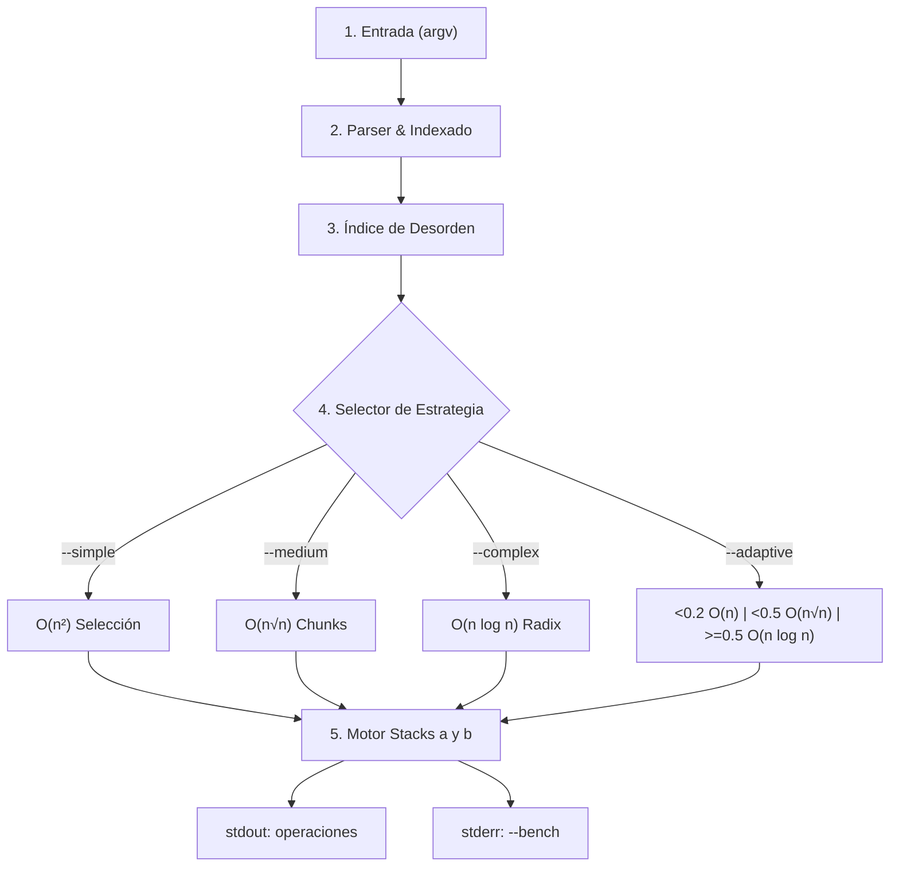

*Este proyecto ha sido creado como parte del currículo de 42 por alavryk, alsadyko.*

## Descripción
**Push_swap** es un proyecto de algorítmica en C cuyo objetivo es ordenar una pila de números enteros (`stack a`) utilizando una pila auxiliar (`stack b`) y un conjunto limitado de 11 operaciones (`sa`, `sb`, `ss`, `pa`, `pb`, `ra`, `rb`, `rr`, `rra`, `rrb`, `rrr`).

Esta implementación incluye:
* Cálculo previo del **índice de desorden** en el rango `[0, 1]`.
* Cuatro estrategias seleccionables por argumento: `--simple` (\(O(n^2)\)), `--medium` (\(O(n\sqrt{n})\)), `--complex` (\(O(n \log n)\)) y `--adaptive` (por defecto).
* Modo de métricas `--bench` con salida formateada en `stderr`.
* Programa bonus `checker` para validar secuencias de instrucciones desde `stdin`.

```text
  [ argv ] ──▶ [ Parser & Indexado ] ──▶ [ Índice Desorden ]
                                                 │
         ┌───────────────────┬───────────────────┼───────────────────┐
         ▼                   ▼                   ▼                   ▼
   --simple O(n²)     --medium O(n√n)    --complex O(n log n)   --adaptive
   (Selección min)    (Chunks √n)        (Radix LSD binario)    (<0.2 | <0.5 | >=0.5)
         └───────────────────┴───────────────────┼───────────────────┘
                                                 ▼
                                    [ Motor Stacks a y b ]
                                       ├──▶ stdout: ops
                                       └──▶ stderr: --bench
```

## Contribuciones del equipo
* **alavryk:** Diseño de arquitectura, parser de argumentos y flags, indexado de datos, motor de operaciones de stacks, algoritmos de ordenación (`simple`, `medium`, `complex`, `adaptive`), modo `--bench` y programa bonus `checker`.
* **alsadyko:** Revisión de casos borde, pruebas de rendimiento y validación de memoria.

## Algoritmos, umbrales y análisis de complejidad



### 1. Estrategias implementadas
* **Simple (`--simple` — \(O(n^2)\)):** Selección directa del mínimo. Localiza el menor elemento en `a`, decide si es más corto subirlo con `ra` o `rra`, y lo envía a `b` (`pb`) hasta ordenar los 3 últimos elementos con `sort_three`.
* **Intermedio (`--medium` — \(O(n\sqrt{n})\)):** Partición por *chunks* (ventanas de tamaño \(\approx 1.4\sqrt{n}\)). Empuja bloques de índices a `b` dejando los mayores arriba (`rb` para la mitad inferior del bloque) y luego devuelve los máximos a `a` por la ruta más corta.
* **Complejo (`--complex` — \(O(n \log n)\)):** **Radix Sort binario (LSD)**. Tras normalizar los valores a índices `[0..n-1]`, evalúa bit a bit desde el menos significativo (`bit = 0`) hasta \(\lceil \log_2 n \rceil\): envía los `0` a `b` (`pb`) y rota los `1` en `a` (`ra`), reuniendo todo al final de cada pasada (`pa`).
* **Adaptativo (`--adaptive` — Por defecto):**
  * **Desorden \(< 0.2\) (\(O(n)\)):** Barrido lineal único con intercambios locales (`sa` + `ra`) y rotación mínima para llevar el elemento `0` a la cima, evitando el coste de dividir en bloques cuando la lista ya está casi ordenada.
  * **Desorden \(0.2 \le d < 0.5\) (\(O(n\sqrt{n})\)):** Aplica la estrategia *Medium* por *chunks*, aprovechando la cercanía relativa de los rangos sin pagar las \(\log_2 n\) pasadas completas de Radix.
  * **Desorden \(\ge 0.5\) (\(O(n \log n)\)):** Aplica *Radix Sort* para garantizar un coste acotado y estable (~1.080 ops en 100 elementos y ~6.700 ops en 500 elementos).

```text
  Stack a (entrada)      Stack b (auxiliar)
     [ 3 ] ── pb ──▶        [ 0 ]
     [ 1 ]                  [ 2 ]
     [ 4 ] ◀── pa ──        [   ]
```

### 2. Cotas de complejidad (Modelo Push_swap)

| Estrategia | Operaciones (Tiempo) | Memoria auxiliar (Espacio) |
| :--- | :--- | :--- |
| Simple | $O(n^2)$ | $O(n)$ |
| Medium | $O(n\sqrt{n})$ | $O(n)$ |
| Complex (Radix) | $O(n \log n)$ | $O(n)$ |
| Adaptive ($d < 0.2$) | $O(n)$ | $O(n)$ |

## Instrucciones

### Compilación
```bash
make        # Compila libft y genera el ejecutable push_swap
make bonus  # Compila libft y genera el ejecutable checker
make fclean # Elimina objetos y ejecutables
```

### Ejecución y pruebas

Ordenar y verificar con checker
```bash
 ARG="4 67 3 87 23"; ./push_swap $ARG | ./checker $ARG
```
# Ejecutar con métricas de rendimiento en stderr
```bash
ARG=$(shuf -i 0-9999 -n 500 | tr '\n' ' '); ./push_sw
ap --bench $ARG |./checker $ARG
```

## Recursos
* Donald E. Knuth, *The Art of Computer Programming, Vol. 3: Sorting and Searching*.
* Documentación del sistema Unix (`man 2 read`, `man 2 write`, `man 3 malloc`, `man 3 free`).
* **Uso de IA:** Se ha empleado asistencia de IA como apoyo para estructurar la arquitectura modular del proyecto, revisar casos borde del parser y la gestión de memoria dinámica, y redactar la documentación técnica.

